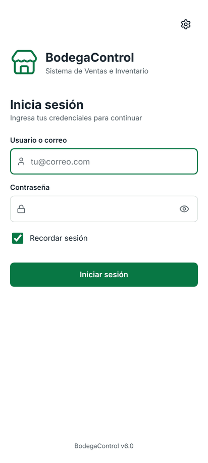
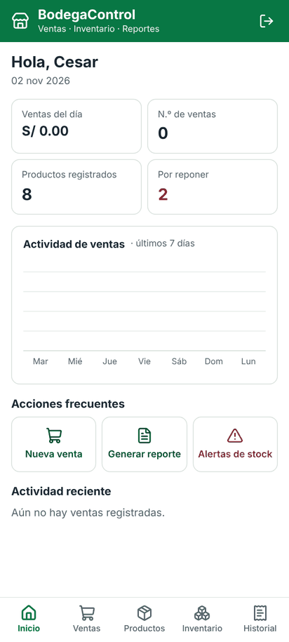
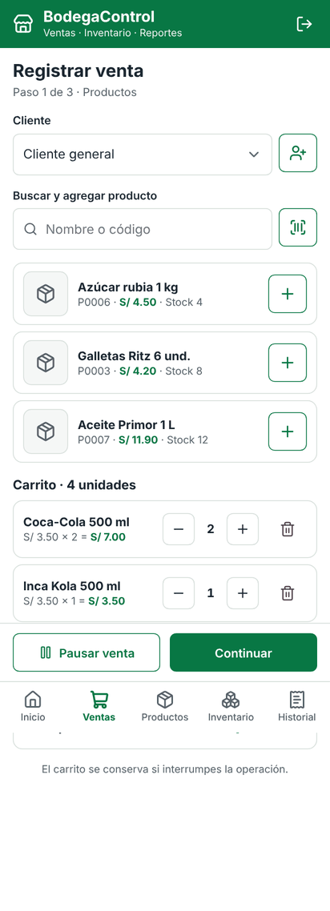
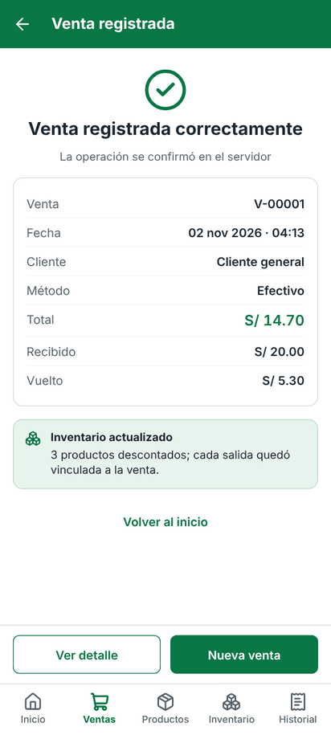
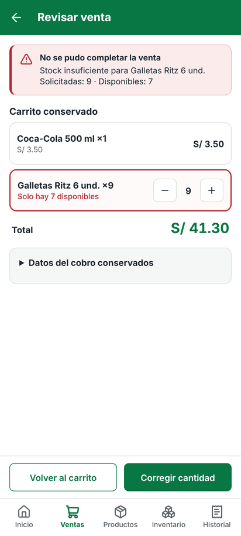
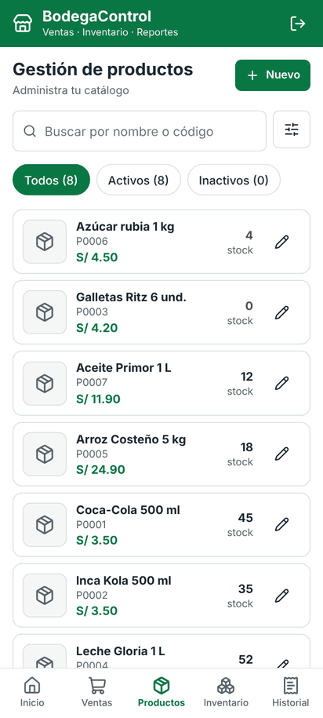
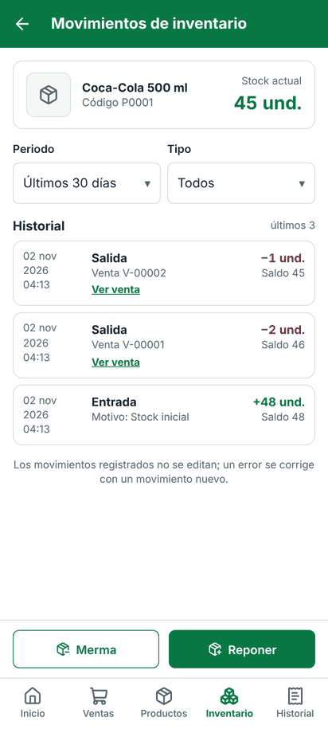
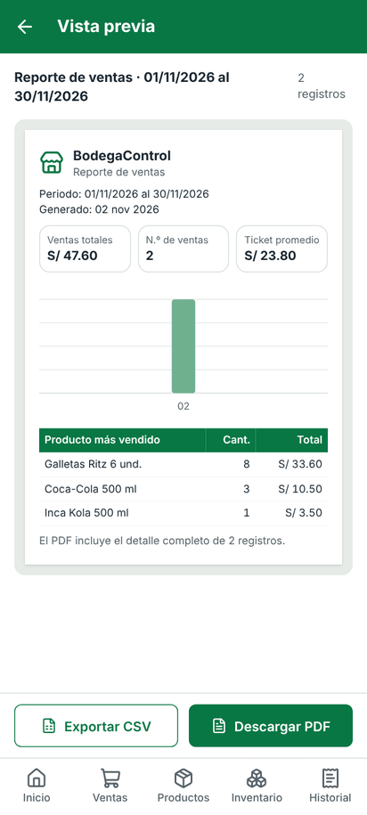
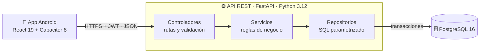

# BodegaControl

**Ventas, inventario y reportes de una bodega desde el celular, con datos que siempre cuadran.**
App Android (React + Capacitor) conectada a una API REST propia (FastAPI) y a PostgreSQL. Cada venta descuenta el stock en el momento, nunca se duplica y alimenta reportes en PDF y CSV.

<p>
  
  
  
  
  
  
  
  
</p>

## Vista previa

Capturas reales de la app consumiendo la API con PostgreSQL (`docs/capturas/`).

<table>
  <tr>
    <td align="center"><br><sub>Inicio de sesión</sub></td>
    <td align="center"><br><sub>Inicio del propietario</sub></td>
    <td align="center"><br><sub>Carrito de venta</sub></td>
    <td align="center"><br><sub>Venta registrada</sub></td>
  </tr>
  <tr>
    <td align="center"><br><sub>Rechazo por stock: el carrito se conserva</sub></td>
    <td align="center"><br><sub>Catálogo de productos</sub></td>
    <td align="center"><br><sub>Trazabilidad del stock</sub></td>
    <td align="center"><br><sub>Reporte PDF / CSV</sub></td>
  </tr>
</table>

## Tabla de contenidos

1. [El problema que resuelve](#el-problema-que-resuelve)
2. [Características principales](#características-principales)
3. [Alcance](#alcance)
4. [Arquitectura](#arquitectura)
5. [Contenido del repositorio](#contenido-del-repositorio)
6. [Requisitos previos](#requisitos-previos)
7. [Instalación y ejecución](#instalación-y-ejecución)
8. [Despliegue en la nube](#despliegue-en-la-nube)
9. [Guía de uso](#guía-de-uso)
10. [API REST](#api-rest)
11. [Pruebas y comandos útiles](#pruebas-y-comandos-útiles)
12. [Estado del proyecto y hoja de ruta](#estado-del-proyecto-y-hoja-de-ruta)
13. [Contribuciones](#contribuciones)
14. [Licencia y autores](#licencia-y-autores)

## El problema que resuelve

En una bodega de barrio las ventas se anotan a mano o no se anotan. El dueño no sabe cuánto stock real tiene, qué productos pierde por vencimiento ni cuánto gana. Cuando deja a otra persona en la caja, pierde el control.

BodegaControl registra cada venta desde el celular, descuenta el stock en la misma operación y entrega reportes por periodo. Lo usan dos roles:

| Rol | Puede hacer |
|---|---|
| **Propietario** | Todo: vender, gestionar el catálogo, reponer mercadería, registrar mermas y ver reportes con costos y ganancias. |
| **Cajero** | Vender, buscar productos y registrar clientes. No ve costos ni ganancias y solo consulta sus propias ventas. |

## Características principales

**Ventas**
- Venta en tres pasos (carrito → cobro → confirmación) con búsqueda por nombre, código o escáner de código de barras.
- Pagos en efectivo con cálculo de vuelto, y Yape, Plin o tarjeta (débito o crédito) con N.º de operación verificado y único.
- **Sin ventas duplicadas:** cada venta lleva una clave de idempotencia; si se corta la red, la app consulta el estado antes de reenviar.
- **Venta completa o nada:** venta, detalle, pago y movimientos de stock se guardan en una sola transacción.
- Si falta stock, el carrito se conserva y se marca solo la línea que hay que corregir.
- Venta pausada: el carrito queda guardado en el celular y se descarta solo a las 2 horas.

**Catálogo e inventario**
- Productos con foto obligatoria (comprimida a menos de 500 KB), código correlativo automático (P0001…) y stock mínimo.
- El stock **solo cambia mediante movimientos** (alta, entrada, venta, merma), con trazabilidad completa por producto.
- Reposiciones con N.º de entrada automático (E-00001…) y tipo de comprobante del proveedor.
- Mermas por vencimiento, daño o faltante, con la pérdida calculada en soles.

**Clientes, historial y reportes**
- Clientes opcionales con DNI, RUC o carné de extranjería validados.
- Historial con las últimas 40 ventas y su detalle con los precios del momento.
- Tablero de inicio con las ventas del día, la serie de 7 días y las alertas de reposición.
- Reportes de ventas y mermas en vista previa, PDF y CSV para Excel, en 9 periodos calculados en hora de Lima, con auditoría de cada exportación.

**Seguridad e integridad**
- Autenticación JWT y contraseñas con bcrypt; el rol se verifica en el servidor en cada solicitud.
- El servidor decide precios y totales: la app no puede enviarlos.
- La base de datos rechaza por sí misma los datos inválidos (CHECK, FK y triggers), aunque falle el backend.

## Alcance

| Incluido en la versión 1.0 | Fuera del alcance actual |
|---|---|
| Ventas con efectivo, Yape, Plin y tarjeta (referencia verificada por el cajero) | Cobro automático con pasarela de pagos |
| Un medio de pago por venta | Ventas con pago mixto |
| Catálogo, reposiciones y mermas | Devoluciones y anulación de ventas |
| Historial y reportes por periodo | Cierre de caja por turno |
| Un local, dos roles | Varios locales o almacenes |
| Clientes registrados manualmente | Consulta automática de DNI en RENIEC |
| App Android | Versión iOS y predicción de demanda |

## Arquitectura



| Capa | Responsabilidad |
|---|---|
| **App Android** | Interfaz, formularios, borrador del carrito y solicitudes HTTP. No guarda datos de negocio. |
| **Controladores** | Rutas, códigos HTTP, autenticación y validación de entrada (Pydantic). |
| **Servicios** | Reglas de negocio, permisos por rol, transacciones e idempotencia. |
| **Repositorios** | SQL parametrizado, sin lógica de negocio. |
| **PostgreSQL** | 11 tablas, 6 vistas y 10 funciones con triggers: stock derivado de movimientos, registros inmutables y validación de venta completa. |

En producción, la API corre en **Vercel** y la base de datos en **Neon**. Para desarrollo local se usa **Docker**.

## Contenido del repositorio

```
bodegacontrol/
├── base-datos/                 Modelo de datos
│   ├── 01_esquema.sql          Tablas, restricciones, triggers y vistas
│   ├── 02_datos_iniciales.sql  Usuarios y catálogo de demostración
│   ├── 03_pruebas_esquema.py   47 pruebas de integridad directas contra PostgreSQL
│   ├── 04_modelo_er.png        Diagrama entidad-relación
│   └── DICCIONARIO_DE_DATOS.md Descripción de cada tabla y atributo
├── backend/                    API REST
│   ├── app/
│   │   ├── controladores/      Rutas HTTP por recurso
│   │   ├── servicios/          Reglas de negocio (ventas, inventario, reportes…)
│   │   ├── repositorios/       Acceso a datos con SQL parametrizado
│   │   ├── esquemas.py         Contratos de entrada validados
│   │   ├── seguridad.py        JWT y permisos por rol
│   │   └── main.py             Punto de entrada
│   ├── pruebas/                47 pruebas de la API con pytest
│   ├── Dockerfile
│   └── requirements.txt
├── app-android/                Cliente móvil
│   ├── src/
│   │   ├── api/                Cliente HTTP y un método por endpoint
│   │   ├── estado/             Sesión y borrador de venta
│   │   ├── componentes/        Estructura de pantalla y controles reutilizables
│   │   └── pantallas/          Inicio, ventas, productos, inventario, historial, reportes…
│   ├── android/                Proyecto nativo para Android Studio
│   └── pruebas-e2e/            Recorrido automatizado de 21 flujos
├── docs/
│   ├── API.md                  Documentación completa de la API
│   ├── postman/                Colección Postman y entornos (local y Vercel)
│   └── capturas/               Capturas de la app
└── docker-compose.yml          Base de datos + API en un comando
```

## Requisitos previos

| Herramienta | Versión | Uso |
|---|---|---|
| [Git](https://git-scm.com) | Reciente | Clonar el repositorio |
| [Docker Desktop](https://www.docker.com/products/docker-desktop/) | Reciente | Base de datos y API locales (recomendado) |
| [Node.js](https://nodejs.org) | **22 LTS** | App en el navegador y compilación del APK |
| [Python](https://www.python.org/downloads/) | **3.12** | Pruebas automáticas o API sin Docker |
| [Android Studio](https://developer.android.com/studio) | Quail 2026.1 o superior | Generar el APK |
| [Postman](https://www.postman.com/downloads/) | Reciente | Probar la API (opcional) |

## Instalación y ejecución

### 1. Clonar el repositorio

```bash
git clone https://github.com/cadionicio/bodegacontrol.git
cd bodegacontrol
```

### 2. Base de datos y API

**Opción A · Docker** (recomendada, no requiere instalar PostgreSQL ni Python):

```bash
docker compose up --build
```

La base de datos se crea con el esquema y los datos de demostración la primera vez. Para volver a los datos iniciales: `docker compose down -v` y luego `docker compose up --build`.

**Opción B · Python y PostgreSQL instalados:**

```bash
psql -U postgres -c "CREATE DATABASE bodega"
psql -U postgres -d bodega -f base-datos/01_esquema.sql
psql -U postgres -d bodega -f base-datos/02_datos_iniciales.sql

cd backend
python -m venv .venv
source .venv/bin/activate            # Windows: .venv\Scripts\activate
pip install -r requirements-dev.txt
cp .env.example .env                 # editar DATABASE_URL y JWT_SECRETO
uvicorn app.main:app --reload --env-file .env
```

Verificación:

| Dirección | Resultado esperado |
|---|---|
| <http://localhost:8000/api/v1/salud> | `{"estado": "OK", …}` |
| <http://localhost:8000/docs> | Documentación interactiva (Swagger) |

### 3. Variables de entorno de la API (`backend/.env`)

| Variable | Obligatoria | Descripción |
|---|---|---|
| `DATABASE_URL` | Sí | Cadena de conexión a PostgreSQL. En Neon, la conexión directa con `sslmode=require`. |
| `JWT_SECRETO` | Sí | Secreto para firmar tokens, de 32 caracteres o más. |
| `JWT_HORAS_VALIDEZ` | No | Duración de la sesión (por defecto, 12 horas). |
| `ORIGENES_CORS` | No | Orígenes permitidos (por defecto, la app Android y `http://localhost:5173`). |
| `TAMANO_POOL` | No | Conexiones simultáneas (2 en Vercel). |

> El archivo `.env` nunca se sube al repositorio.

### 4. App en el navegador (desarrollo)

```bash
cd app-android
cp .env.example .env                 # cambiar a VITE_API_URL=http://localhost:8000
npm ci
npm run dev                          # http://localhost:5173
```

En Chrome, **F12** y luego **Ctrl + Shift + M** muestran la app con tamaño de celular.

### 5. APK para Android

```bash
cd app-android
npm ci
npm run android                      # compila la app web y la copia al proyecto Android
npx cap open android                 # abre Android Studio
```

En Android Studio: **Build → Build App Bundle(s) / APK(s) → Build APK(s)**. El archivo queda en `android/app/build/outputs/apk/debug/app-debug.apk`. Más detalles en [`app-android/README.md`](app-android/README.md).

> Android solo permite servidores **HTTPS**. La dirección de la API se puede cambiar dentro de la app con el ícono ⚙ de la pantalla de inicio de sesión.

## Despliegue en la nube

1. **Neon:** crear un proyecto de PostgreSQL y, en *SQL Editor*, ejecutar `01_esquema.sql` y luego `02_datos_iniciales.sql`. Copiar la cadena de conexión **directa** (sin `-pooler`).
2. **Vercel:** importar el repositorio con *Root Directory* = `backend` y cargar `DATABASE_URL`, `JWT_SECRETO` y `TAMANO_POOL=2` en *Environment Variables*.
3. **Verificar:** `https://<proyecto>.vercel.app/api/v1/salud` debe responder `{"estado": "OK"}`.

## Guía de uso

### Usuarios de demostración

| Rol | Correo | Contraseña |
|---|---|---|
| Propietario | `cadionicio@gmail.com` | `Propietario2026` |
| Cajero | `giancarlo@uni.pe` | `Cajero2026` |

> Son credenciales de demostración incluidas en `02_datos_iniciales.sql`. Cámbielas antes de usar el sistema con datos reales.

### Registrar una venta

1. Inicie sesión y abra la pestaña **Ventas**.
2. Busque o escanee los productos y ajuste las cantidades → **Continuar**.
3. Elija el método de pago. En efectivo, escriba el importe recibido; en Yape, Plin o tarjeta, escriba el N.º de operación y marque que lo verificó → **Continuar**.
4. Pulse **Confirmar venta**. La app muestra el total, el vuelto y el stock actualizado.

Ejemplo con los datos de demostración: 2 Coca-Cola 500 ml y 1 Leche Gloria 1 L, pagando S/ 20.00 en efectivo, dan un total de **S/ 11.80** y un vuelto de **S/ 8.20**.

### Otras operaciones

| Operación | Dónde |
|---|---|
| Crear o editar productos | **Productos → Nuevo** (propietario) |
| Reponer mercadería | **Inventario → Registrar entrada** |
| Registrar una merma | **Inventario → Registrar merma** |
| Ver la historia de un producto | **Inventario →** producto **→ Ver movimientos** |
| Consultar ventas anteriores | **Historial** |
| Generar reportes PDF o CSV | **Inicio → Generar reporte** (propietario) |

## API REST

24 operaciones bajo `/api/v1`, todas consumidas por la app. La documentación completa, con parámetros, ejemplos JSON reales y códigos HTTP, está en [`docs/API.md`](docs/API.md). La colección Postman está en [`docs/postman/`](docs/postman/).

| Recurso | Endpoints |
|---|---|
| Autenticación | `POST /auth/login` · `GET /auth/sesion` |
| Productos | `GET` `POST /productos` · `GET` `PATCH` `DELETE /productos/{id}` · `GET /productos/codigo-barras/{codigo}` · `PUT` `GET` `DELETE /productos/{id}/imagen` |
| Inventario | `GET /inventario/{id}` · `POST /inventario/{id}/entradas` · `POST /inventario/{id}/mermas` |
| Clientes | `GET` `POST /clientes` |
| Ventas | `POST /ventas` · `GET /ventas/estado?clave=` · `GET /ventas` · `GET /ventas/{id}` |
| Reportes | `GET /reportes/resumen` · `GET /reportes/{ventas\|mermas}` · `GET /reportes/exportaciones` |
| Sistema | `GET /salud` |

Ejemplo: iniciar sesión y registrar una venta.

```bash
TOKEN=$(curl -s -X POST http://localhost:8000/api/v1/auth/login \
  -H "Content-Type: application/json" \
  -d '{"correo": "giancarlo@uni.pe", "contrasena": "Cajero2026"}' | python -c "import sys, json; print(json.load(sys.stdin)['token'])")

curl -X POST http://localhost:8000/api/v1/ventas \
  -H "Authorization: Bearer $TOKEN" -H "Content-Type: application/json" \
  -d '{"clave_idempotencia": "8e710ad8-92b2-4216-a290-bdcbda178fb4",
       "lineas": [{"producto_id": 1, "cantidad": 2}, {"producto_id": 4, "cantidad": 1}],
       "pago": {"metodo": "EFECTIVO", "importe_recibido": 20.00}}'
```

Todas las respuestas de error usan el mismo formato:

```json
{ "codigo": "STOCK_INSUFICIENTE", "mensaje": "Cantidad no disponible",
  "errores": [{ "producto_id": 5, "solicitado": 9999, "disponible": 18 }], "conservar_borrador": true }
```

## Pruebas y comandos útiles

| Suite | Comando | Resultado |
|---|---|---|
| Integridad de la base de datos | `DATABASE_URL=postgresql://… python base-datos/03_pruebas_esquema.py` | 47/47 |
| API con PostgreSQL real | `cd backend && DATABASE_URL_PRUEBAS=postgresql://…/bodega_pruebas pytest pruebas -q` | 47 passed |
| Colección Postman | `cd docs/postman && npx newman run BodegaControl.postman_collection.json -e BodegaControl.local.postman_environment.json --working-dir .` | 49 solicitudes · 68 verificaciones |
| App de extremo a extremo | `cd app-android && VITE_API_URL=http://localhost:8000 npm run dev`, y en otra terminal `node pruebas-e2e/recorrido.cjs` | 21/21 flujos |

> ⚠️ `DATABASE_URL_PRUEBAS` debe apuntar a una base desechable: las pruebas de la API la **borran y recrean**.

| Tarea | Comando |
|---|---|
| Levantar base de datos y API | `docker compose up --build` |
| Reiniciar los datos de demostración | `docker compose down -v` |
| API en modo desarrollo | `cd backend && uvicorn app.main:app --reload --env-file .env` |
| App en el navegador | `cd app-android && npm run dev` |
| Compilar la app web | `cd app-android && npm run build` |
| Preparar el proyecto Android | `cd app-android && npm run android` |
| Consultar las últimas ventas en la base | `docker compose exec base_datos psql -U bodega -d bodega -c "SELECT * FROM bc.v_venta_resumen ORDER BY venta_id DESC LIMIT 5;"` |

## Estado del proyecto y hoja de ruta

**Estado:** versión 1.0 funcional. La API, la base de datos y la app están completas y probadas.

**Mejoras planificadas:**
- [ ] Cierre de caja por turno, con arqueo de efectivo.
- [ ] Devoluciones y anulación de ventas con reversión de stock.
- [ ] Ventas con pago mixto (por ejemplo, efectivo + Yape).
- [ ] Integración con una pasarela de pagos para confirmar cobros automáticamente.
- [ ] Consulta de DNI y RUC en servicios oficiales.
- [ ] Soporte para varios locales.
- [ ] Predicción de demanda a partir del historial de ventas.

## Contribuciones

1. Cree una rama desde `main`: `git checkout -b mejora/descripcion-corta`.
2. Mantenga el estilo del proyecto: nombres en español, comentarios que expliquen el porqué y capas separadas (controlador → servicio → repositorio).
3. Agregue o actualice las pruebas y verifique que todas pasen.
4. Abra un *Pull Request* que describa el cambio y cómo se probó.

Nunca suba archivos `.env`, contraseñas ni claves.

## Licencia y autores

**Licencia:** por definir. Hasta que se publique un archivo `LICENSE`, todos los derechos quedan reservados a los autores.

Proyecto académico desarrollado para el curso **SI806V – Desarrollo Adaptativo e Integración de Software**, Facultad de Ingeniería Industrial y de Sistemas, Universidad Nacional de Ingeniería (ciclo 2026-2). Profesor: Ramos Montes, Carlos Nelson.

**Integrantes (Grupo 2):**
- Aguirre Alvarado, Giancarlo
- Dionicio Achachagua, Cesar Alonso
- Salazar Ramos, Ernesto Ramón
